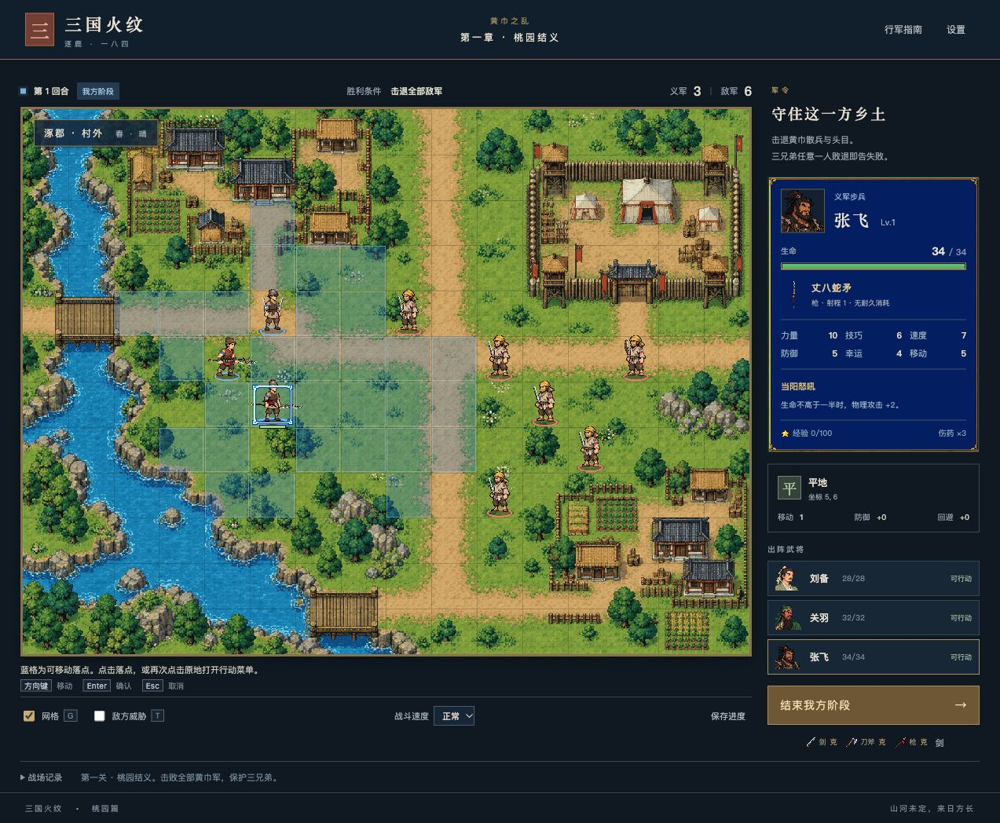

# 三国火纹

原创三国题材单机战棋，使用 React、TypeScript 与 Canvas 2D。当前工程实现第一章「桃园结义」：桃园立誓、村外迎战、胜败结算、简雍战后入队与本地进度保存。其他章节保留为内容规划，尚不能进入。



## 获取源码

```sh
git clone https://github.com/LeP-Ton/sanguo-fire-emblem.git
cd sanguo-fire-emblem
```

## 本地启动

需要 Node.js 20.19 或更高版本。运行素材已包含在 `game/public/art/`，首次启动无需访问原美术库或重新导入。

```sh
cd game
npm ci
npm run dev -- --port 5174
```

打开 [本地游戏](http://127.0.0.1:5174/)。也可以通过 `--port` 指定其他未占用的端口。

地图点击武将与蓝色落点，再选择攻击、伤药或待机；方向键移动光标，Enter 确认，Esc 或右键返回。攻击前可撤销移动，提交行动后不能撤回。完整操作、存档限制与资源导入方式见 [游戏说明](game/README.md)。

## 检查与构建

在 `game/` 中执行：

```sh
npm run typecheck
npm test
npm run check:map
npm run check:assets
npm run build
npm run preview -- --port 4174
```

构建产物为 `game/dist/`，使用相对资源地址，可放在 HTTP 静态服务器的根目录或子目录。游戏运行不需要在线 AI 服务或后端；请通过 HTTP 访问，不直接双击 `index.html` 使用 `file://`。

## 工程与进展

- [game/README.md](game/README.md)：安装、操作、存档、资源与目录说明。
- [首关需求入口](.agentdocs/workflow/REQ-20261104141123-首关可玩原型/README.md)：当前状态、验收证据、未验证项与后续事项。
- [需求索引](.agentdocs/index.md)：各项工作的导航。
- [项目规范](AGENTS.md)：长期开发约定。

规则测试、构建、浏览器实玩与用户视觉验收分别记录；实际验收结论以需求入口及其阶段记录为准。
